

<a href="https://al-scripting.github.io/about-me/"><picture><source media="(prefers-color-scheme: dark)" srcset="https://raw.githubusercontent.com/Al-Scripting/Al-Scripting/main/assets/glass/hero-dark.svg" /></picture></a>

<a href="https://al-scripting.github.io/about-me/"><picture><source media="(prefers-color-scheme: dark)" srcset="https://raw.githubusercontent.com/Al-Scripting/Al-Scripting/main/assets/glass/pill-portfolio-dark.svg" /></picture></a>
<a href="https://www.linkedin.com/in/al-mohamed-shifan-5266b924b/"><picture><source media="(prefers-color-scheme: dark)" srcset="https://raw.githubusercontent.com/Al-Scripting/Al-Scripting/main/assets/glass/pill-linkedin-dark.svg" /></picture></a>
<a href="https://scholar.google.ca/citations?user=0OwX660AAAAJ&hl=en"><picture><source media="(prefers-color-scheme: dark)" srcset="https://raw.githubusercontent.com/Al-Scripting/Al-Scripting/main/assets/glass/pill-scholar-dark.svg" /></picture></a>
<a href="https://cslab.quest/"><picture><source media="(prefers-color-scheme: dark)" srcset="https://raw.githubusercontent.com/Al-Scripting/Al-Scripting/main/assets/glass/pill-lab-dark.svg" /></picture></a>
<a href="https://al-scripting.github.io/about-me/assets/Al-Shifan-Resume-2026.pdf"><picture><source media="(prefers-color-scheme: dark)" srcset="https://raw.githubusercontent.com/Al-Scripting/Al-Scripting/main/assets/glass/pill-cv-dark.svg" /></picture></a>

I am an MSc student in Computer Science (Software Design) at **Ontario Tech University**, and a Graduate
Research Assistant at the **[Code & Sorcery Lab](https://cslab.quest/)**. My bachelor's degree is a
BIT in Networking and IT Security, with Dean's List and the CCNA.

Networking and security by training. Software design and AI by research. I am not a game developer.
I am a software designer who uses games as a tool to test new ideas, from reinforcement learning
agents to LLM characters that remember and stay in character.

<picture><source media="(prefers-color-scheme: dark)" srcset="https://raw.githubusercontent.com/Al-Scripting/Al-Scripting/main/assets/glass/h-research-dark.svg" /></picture>

<a href="https://arxiv.org/abs/2611.05601"><picture><source media="(prefers-color-scheme: dark)" srcset="https://raw.githubusercontent.com/Al-Scripting/Al-Scripting/main/assets/glass/paper-ridge-dark.svg" /></picture></a>
<a href="https://github.com/Code-SorceryLab/PEAK-DRL-Tool"><picture><source media="(prefers-color-scheme: dark)" srcset="https://raw.githubusercontent.com/Al-Scripting/Al-Scripting/main/assets/glass/paper-peak-dark.svg" /></picture></a>
 
<a href="https://doi.org/10.5281/zenodo.21184301"><picture><source media="(prefers-color-scheme: dark)" srcset="https://raw.githubusercontent.com/Al-Scripting/Al-Scripting/main/assets/glass/paper-tast-dark.svg" /></picture></a>
<a href="https://al-scripting.github.io/about-me/#contact"><picture><source media="(prefers-color-scheme: dark)" srcset="https://raw.githubusercontent.com/Al-Scripting/Al-Scripting/main/assets/glass/paper-slr-dark.svg" /></picture></a>

<picture><source media="(prefers-color-scheme: dark)" srcset="https://raw.githubusercontent.com/Al-Scripting/Al-Scripting/main/assets/glass/h-projects-dark.svg" /></picture>

<a href="https://al-scripting.github.io/about-me/#projects"><picture><source media="(prefers-color-scheme: dark)" srcset="https://raw.githubusercontent.com/Al-Scripting/Al-Scripting/main/assets/glass/project-afterstate-dark.svg" /></picture></a>
<a href="https://github.com/Al-Scripting/FATHOM"><picture><source media="(prefers-color-scheme: dark)" srcset="https://raw.githubusercontent.com/Al-Scripting/Al-Scripting/main/assets/glass/project-fathom-dark.svg" /></picture></a>
 
<a href="https://github.com/Code-SorceryLab/PEAK-DRL-Tool"><picture><source media="(prefers-color-scheme: dark)" srcset="https://raw.githubusercontent.com/Al-Scripting/Al-Scripting/main/assets/glass/project-peak-dark.svg" /></picture></a>
<a href="https://al-scripting.github.io/about-me/#projects"><picture><source media="(prefers-color-scheme: dark)" srcset="https://raw.githubusercontent.com/Al-Scripting/Al-Scripting/main/assets/glass/project-rogue-dark.svg" /></picture></a>
 
<a href="https://al-scripting.github.io/about-me/#projects"><picture><source media="(prefers-color-scheme: dark)" srcset="https://raw.githubusercontent.com/Al-Scripting/Al-Scripting/main/assets/glass/project-raven-dark.svg" /></picture></a>
<a href="https://tinybrains.dev/leaderboard"><picture><source media="(prefers-color-scheme: dark)" srcset="https://raw.githubusercontent.com/Al-Scripting/Al-Scripting/main/assets/glass/project-raze-dark.svg" /></picture></a>
 
<a href="https://github.com/Al-Scripting/HackHive2026"><picture><source media="(prefers-color-scheme: dark)" srcset="https://raw.githubusercontent.com/Al-Scripting/Al-Scripting/main/assets/glass/project-gestura-dark.svg" /></picture></a>
<a href="https://github.com/Al-Scripting/Local-AI-Dungeon-Ollama-Python"><picture><source media="(prefers-color-scheme: dark)" srcset="https://raw.githubusercontent.com/Al-Scripting/Al-Scripting/main/assets/glass/project-dungeon-dark.svg" /></picture></a>

Also: <a href="https://github.com/Code-SorceryLab/steam-patch-notes">steam-patch-notes</a> · <a href="https://github.com/Code-SorceryLab/Procedural-Graph-Tools">Procedural-Graph-Tools</a> · <a href="https://github.com/Code-SorceryLab/EMBR">EMBR</a>

<picture><source media="(prefers-color-scheme: dark)" srcset="https://raw.githubusercontent.com/Al-Scripting/Al-Scripting/main/assets/glass/h-lab-dark.svg" /></picture>

<a href="https://cslab.quest/"><picture><source media="(prefers-color-scheme: dark)" srcset="https://raw.githubusercontent.com/Al-Scripting/Al-Scripting/main/assets/glass/lab-dark.svg" /></picture></a>

I work in these lab tracks: [the LLM-NPC landscape](https://cslab.quest/projects/llm-npc-landscape/) ·
[emotional memory in generative characters](https://cslab.quest/projects/emotional-memory-npcs/) ·
[staying in character](https://cslab.quest/projects/persona-stability/) ·
[one agent, many play styles](https://cslab.quest/projects/behavioural-coverage-rl/) ·
[PEAK: authoring and training in one loop](https://cslab.quest/projects/peak-engine/)

<picture><source media="(prefers-color-scheme: dark)" srcset="https://raw.githubusercontent.com/Al-Scripting/Al-Scripting/main/assets/glass/h-shipped-dark.svg" /></picture>

- **P4 on Intel Tofino.** I built research infrastructure on programmable switches. My data-plane programs read per-flow telemetry at line rate.
- **Security.** I assessed a WooCommerce and Stripe stack and audited more than 30 plugins. The team uses my hardening checklist as its pre-deploy gate.
- **Lab operations.** I cut lab network downtime by about 20% for more than 50 daily users.
- **Teaching.** TA for Web Development, Networking I and II, and Advanced Networking I to III, for about 120 undergraduates each term.

<picture><source media="(prefers-color-scheme: dark)" srcset="https://raw.githubusercontent.com/Al-Scripting/Al-Scripting/main/assets/glass/h-stack-dark.svg" /></picture>

<b>Open the full list</b>

 

**Languages** &nbsp;

**AI / ML** &nbsp;

**Games** &nbsp;

**Networks / Security** &nbsp;

**Web / Systems** &nbsp;


<i>A script makes this card each day. See <a href="https://github.com/Al-Scripting/Al-Scripting/blob/main/scripts/activity_card.py">scripts/activity_card.py</a>.</i>

<!-- METRICS DASHBOARDS — uncomment once the METRICS_TOKEN secret exists and the
     "GitHub metrics" workflow has run green. Until then these files do not exist
     and would render as broken images.

-->

<picture>
  <source media="(prefers-color-scheme: dark)" srcset="https://raw.githubusercontent.com/Al-Scripting/Al-Scripting/output/github-snake-dark.svg" />
  <source media="(prefers-color-scheme: light)" srcset="https://raw.githubusercontent.com/Al-Scripting/Al-Scripting/output/github-snake.svg" />
  
</picture>

<i>The best software feels like a game.</i>

